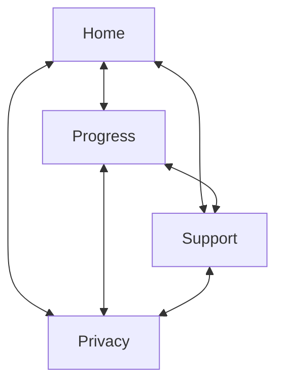
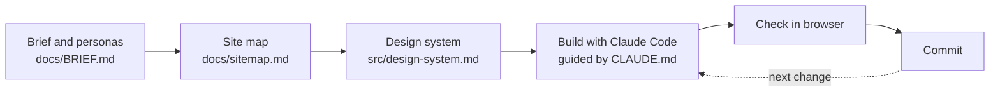

<div align="center">

# 🌿 HabitTrail

**Build habits that stick.**

A website for a habit-tracking app: check in daily, stay on track with reminders, and see your progress over time.


</div>

> [!NOTE]
> **Project note:** HabitTrail is a simple project for practicing AI-assisted prototyping and design workflows. It is a learning project, not a shipping product.

## ✨ Features at a glance

<table align="center">
  <tr>
    <td align="center" width="25%">
      <h3>✅</h3>
      <b>Daily check-ins</b><br>
      Mark a habit done in one tap.
    </td>
    <td align="center" width="25%">
      <h3>⏰</h3>
      <b>Reminders</b><br>
      Get a nudge at the time that works for you.
    </td>
    <td align="center" width="25%">
      <h3>🔥</h3>
      <b>Streaks</b><br>
      See how many days in a row you've kept going.
    </td>
    <td align="center" width="25%">
      <h3>📈</h3>
      <b>Progress view</b><br>
      Look back at how your habits are going over time.
    </td>
  </tr>
</table>

## 🗺️ Site map

Every page shares the same navigation (Home, Progress, Support, Privacy), so a visitor can reach any page from any other page, even if they land directly on Support or Privacy from a search result.



## 🤖 AI-assisted workflow

The site was built in small steps with [Claude Code](https://claude.com/claude-code). A written brief and a design system keep each step on track, and every change is checked in a browser before it is committed.



| Step | What it produces |
|------|------------------|
| **Brief and personas** | Who the site is for, what each page must contain, and its success criteria |
| **Site map** | How the pages link to each other |
| **Design system** | Colors, type, spacing and component rules that the code must follow |
| **Build with Claude Code** | HTML and CSS, guided by the project instructions in [CLAUDE.md](CLAUDE.md) |
| **Check in browser** | A human review of each change at different viewport widths |
| **Commit** | One focused change per commit, so the history reads as a design log |

## 📄 Pages

| Page | Purpose | Success criterion |
|------|---------|-------------------|
| [**Home**](index.html) | Introduces HabitTrail, lists its main features, and links to download the app | A first-time visitor can explain, in one sentence, what HabitTrail does |
| [**See your progress**](progress.html) | Shows, with example data, what streaks and progress look like in the app, and links to download it | A visitor can describe what streaks and progress look like in the app without downloading it first |
| [**Support**](support.html) | Answers the questions a new user is most likely to have, such as how to set a reminder | A visitor with a common question can find the answer without leaving the page |
| [**Privacy**](privacy.html) | Explains what data HabitTrail collects and why | A visitor can find what data is collected and how to request deletion without searching |

## 🎨 Design

The palette and spacing are defined once as CSS variables in [css/styles.css](css/styles.css) and documented in [src/design-system.md](src/design-system.md).

| Token | Color | Hex |
|-------|-------|-----|
| Cedar (primary) |  | `#225C3A` |
| Sunrise (secondary) |  | `#F6BF60` |
| Sky (tertiary) |  | `#A8D8F0` |
| Fog (background) |  | `#F5F3EC` |
| Bark (text) |  | `#1F2D26` |

Accessibility patterns on every page: a skip link, labelled landmarks, `aria-current="page"` on the current nav link, and one `<h1>` per page.

## 🗂️ Project structure

```text
habit-trail/
├── index.html          Home
├── progress.html       See your progress (example streak and progress visuals)
├── support.html        Support
├── privacy.html        Privacy
├── css/styles.css      Design tokens and styles for all pages
├── js/script.js        Shared script (currently empty)
├── docs/
│   ├── BRIEF.md        Personas, site map, success criteria
│   └── sitemap.md      Page-link diagram
├── src/design-system.md  Design system reference
└── CLAUDE.md           Project instructions for Claude Code
```

## 🚀 Getting started

There is no build step, package manager or test suite. Clone the repo and open `index.html` in a browser.

## 🚧 Status

The layout and styling are in place. Some content is still a placeholder and is waiting on a collaborator:

- Support answers and the contact method
- App Store download links (currently `href="#"`)
- Parts of the privacy copy
