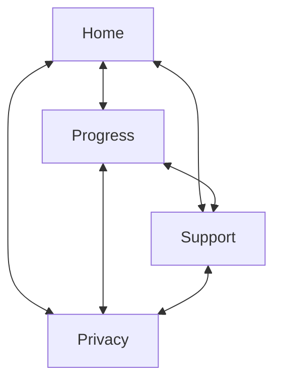

# HabitTrail

## Personas and their one action

- A first-time visitor deciding whether to try HabitTrail. Action: understand what the app does and start using it.
- An existing user who needs help with something, such as setting a reminder. Action: find the answer to a common question.
- A visitor who wants to know what happens to their data before they trust the app. Action: read what HabitTrail collects and why.

## Site map

> _Every page shares the same simple navigation (Home, Progress, Support, Privacy), so a visitor can reach any page from any other page. This also lets someone who lands directly on Support or Privacy, for example from a search result, move around the site without going back through Home first._



## Required content and success criteria
| Page | Description | Success criteria |
|----------|----------|----------|
| **Home**    | Introduces HabitTrail, lists its main features, and gives a visitor a clear next step, such as a link to download the app.   | A first-time visitor can explain, in one sentence, what HabitTrail does.   |
| **Progress**    | Shows, with clearly labelled example data, what streaks and progress look like in the app: streak counts, a calendar of recent days, progress per habit and check-ins by day. Ends with a link to download the app.   | A visitor can describe what streaks and progress look like in the app without downloading it first.   |
| **Support**    | Answers the questions a new user is most likely to have, such as how to set a reminder.   | A visitor with a common question can find the answer without leaving the page.   |
| **Privacy**    | States plainly what data HabitTrail collects, why it collects it, and how a user can ask for it to be deleted.   | A visitor can find what data is collected and how to request deletion without searching.   |


# Ready-to-send prompt

```
Here's my site map and what each page needs to contain:

Every page has the same navigation, so Home, Support, and Privacy
each link to both of the other pages.

Home introduces HabitTrail, lists its main features, and gives a
visitor a clear next step.

Support answers the questions a new user is most likely to have.

Privacy explains what data HabitTrail collects, why, and how a
user could ask for it to be deleted.

Is anything missing that a visitor would expect to find?
```

Sending this lets Claude Code check your plan against what a typical visitor expects, before you build a single page.